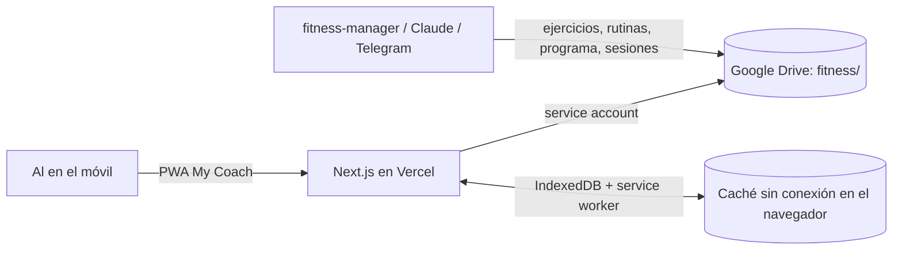

# High-Level Architecture: Fitness Coach

> Project: `fitness-coach`
> Status: Approved (2026-11-12)
> Derived from: `product/product_vision.md` (approved 2026-11-12)

## 1. Architecture Drivers

- Los datos ya viven en la carpeta `fitness` de Google Drive con un contrato definido (`fitness/_system/schema.md`); el Drive sigue siendo la fuente de verdad (Visión §8.1, §9).
- 1 usuario, ~30 ejercicios, ~10 rutinas, ~250 sesiones al año: carga mínima (Visión §10).
- Presupuesto ~0 €, un solo desarrollador con Claude Code (Visión §9).
- Toda la app debe funcionar sin conexión, incluido registrar sesiones (Visión §10).
- Sin logins, pero el programa contiene datos de salud: la credencial de Drive no puede llegar al cliente (Visión §9).
- La app escribe junto a `fitness-manager` (Claude / Telegram) en la misma carpeta (Visión §11).
- El modo guiado necesita temporizadores fiables con el móvil en la mano y la pantalla encendida (Visión §5).
- PWA instalable "My Coach", mobile-first (Visión §9).

## 2. Quality Attribute Targets

No aplica en detalle (`rigor: personal`). Referencias: snapshot en caché visible en < 1 s al abrir; temporizador con desviación < 1 s por minuto aunque la pestaña pase a segundo plano.

## 3. Architectural Style

Un único deployable Next.js en Vercel. Los route handlers del servidor son una pasarela fina hacia Google Drive; el navegador guarda en IndexedDB un snapshot normalizado de los datos y una cola (outbox) de operaciones pendientes, y un service worker sirve la app sin conexión. No hay base de datos. Es la forma más simple que cumple a la vez "sin conexión", "credencial solo en el servidor" y "coste 0".

*Alternativas valoradas:* (a) SPA estática que llama a Drive desde el navegador con OAuth de Google: elimina el servidor, pero obliga a iniciar sesión y a refrescar tokens, contra el driver "sin logins"; (b) Vite SPA + funciones de Vercel: equivalente, pero con más piezas que montar a mano (rutas API, PWA). Next.js gana por tener rutas API y PWA en un solo proyecto con el que el autor ya trabaja.

## 4. System Context

## 5. Surfaces & Building Blocks

Una superficie: `web` (PWA).

| Bloque | Responsabilidad |
|---|---|
| `lib/drive` | Listar y leer la carpeta `fitness`; añadir sesiones a `sessions/al.yaml` con comprobación de `modifiedTime` |
| `api/snapshot` | Construir un JSON normalizado con ejercicios, rutinas, programa, sesiones recientes y vocabularios |
| `api/ops` | Aplicar lotes de operaciones de intención (en el MVP solo `session.complete`) |
| `lib/schema` | Esquemas zod que reflejan `fitness/_system/schema.md` |
| `lib/domain` | Lógica pura: rutinas de hoy, estado del día (pendiente / parcial / completada), filtros, máquina de estados del modo guiado, temporizador basado en marcas de tiempo, construcción de la entrada de sesión |
| `lib/offline` | Snapshot en IndexedDB, outbox y reenvío al recuperar la red, sesión parcial local |
| `components/figure` | Dibujo del monigote en SVG a partir de `figure` |
| UI | Home, selector "Iniciar rutina", modo guiado, resumen, detalle de rutina, Mis rutinas, Mis ejercicios |

## 6. Core Data Model (high level)

Refleja el esquema del Drive: **Exercise** (región, zonas, músculos, nivel, equipamiento, medida, laterality, variants, figure), **Routine** (categoría, días, estado, bloques → items con la dosis personal), **Program** (fase, restricciones, semana), **Session** (fecha, inicio, rutina, estado, duración, ejercicios hechos).

Estado solo en el cliente: la **sesión en curso / parcial** (rutina, fecha, posición actual, series y repeticiones hechas, ejercicios saltados, valoraciones de la interfaz), que nunca sale del dispositivo y se descarta al cambiar de día; la outbox; la clave de acceso.

"Hoy te toca" se calcula con el campo `days` de las rutinas `active` y el día de la semana local; `program.week` es solo una caché y no se usa (el esquema dice que las rutinas prevalecen).

## 7. Key Flows

1. **Abrir la app:** se pinta el snapshot de IndexedDB; si hay red, `GET /api/snapshot` (ETag) lo refresca.
2. **Rutina guiada:** todo el estado vive en el cliente y se guarda en IndexedDB a cada paso (sobrevive a recargas y a cerrar la app). Al terminar con todo hecho, se encola `session.complete`; si se termina antes, queda como parcial local.
3. **Sincronización:** la outbox envía `POST /api/ops` en cuanto hay red; el servidor lee el `sessions/al.yaml` más reciente, añade la entrada si no existe ya (idempotente por `op_id`) y escribe comprobando `modifiedTime`, con un reintento.

## 8. Integrations

| Servicio | Uso | Si no está disponible |
|---|---|---|
| Google Drive API v3 | Leer `fitness/`; añadir sesiones | La app usa el snapshot en caché; las sesiones esperan en la outbox |

## 9. Cross-Cutting Concerns Register

| Asunto | Decisión |
|---|---|
| Logging | Adoptar: logs de las funciones de Vercel, sin datos de salud en los mensajes (solo ids y códigos) |
| Errores | Adoptar: formato de error común en las rutas (tech_standards §3); errores de sincronización visibles en la UI como "pendiente de sincronizar" |
| Secretos | Adoptar: variables de entorno de Vercel y `.env.local` en gitignore |
| Seguridad / privacidad | Adoptar: clave de acceso para **lectura y escritura** (el snapshot contiene la hernia y las restricciones; una URL pública con lectura abierta las expondría) |
| Backups | Adoptar: historial de versiones de Drive; la app nunca borra ni crea ficheros |
| Conflictos de escritura | Adoptar: solo se **añaden** sesiones, read-modify-write con `modifiedTime` y un reintento; idempotencia por `op_id` |
| Sin conexión | Adoptar: service worker (precarga del shell) + snapshot en IndexedDB + outbox |
| Pantalla encendida en modo guiado | Adoptar: Screen Wake Lock API cuando el navegador la ofrece; si no, sin efecto |
| Observabilidad, métricas, trazas | n/a: un usuario |
| Eventos / colas, notificaciones | n/a: no hay trabajos asíncronos ni avisos |
| Feature flags | n/a: un usuario, despliegue directo |
| i18n | n/a: solo español |
| Accesibilidad | Adoptar lo básico: botones grandes para usar con una mano, contraste del kit de UI |
| Analítica | n/a |
| Coste | Planes gratuitos (Vercel Hobby, Drive) |

## 10. Deployment Topology (summary)

Vercel Hobby, proyecto con raíz `apps/fitness-coach`, producción al hacer merge a `main` y despliegues de preview por rama. Variables de entorno: credencial de la service account, id de la carpeta `fitness` y clave de acceso. Los detalles (proyecto de Vercel, qué service account) son de `platform-engineer` o del propio Al.

## 11. Key Decisions

| Decisión | Elegida | ADR |
|---|---|---|
| Framework y hosting | Next.js en Vercel | ninguno (fácil de revertir) |
| Modelo sin conexión y escrituras | Snapshot en IndexedDB + outbox de operaciones de intención, merge en el servidor | [001](adr/001_offline-first-with-operation-outbox.md) |
| Acceso a Drive | Service account con la carpeta `fitness` compartida, credencial en variables de entorno | [002](adr/002_drive-access-via-service-account.md) |
| Clave de acceso para leer y escribir | Una clave compartida, pedida al instalar | [003](adr/003_access-key-for-reads-and-writes.md) |
| Build del service worker | `@serwist/next` en modo configurator + `@serwist/cli` tras `next build` (Turbopack) | [004](adr/004_service-worker-build.md) |
| Runtime | Node 22 LTS | [005](adr/005_node-runtime-22.md) |

## 12. Deliberately Deferred

| Aplazado | Por qué ahora no (driver) | Revisar cuando (señal concreta) |
|---|---|---|
| Base de datos o índice (KV, Postgres) | Visión §10: decenas de ficheros, 1 usuario | Construir el snapshot en frío tarda > 5 s a menudo, o errores de cuota de Drive |
| Escribir rutinas (dosis, orden, History) | Visión §5: edición fuera del MVP | Al definir la feature de edición de rutinas |
| Guardar la valoración por ejercicio | Visión §5: sin efecto en el MVP | Cuando `fitness-manager` amplíe el esquema de `sessions` |
| Sincronizar la sesión parcial entre dispositivos | Visión §10: un dispositivo | Al empieza a usar dos dispositivos |
| Sonido o vibración al llegar a 0 | No pedido | Al lo echa de menos en el uso real |
| Pipeline de CI | Visión §9: esfuerzo mínimo | Una regresión llega a producción dos veces |
| Paquete compartido con my-food-manager (Drive, offline, UI) | Aislamiento entre apps; hoy no hay un proyecto `shared` que lo ofrezca | Una tercera app necesita lo mismo, o Al decide extraerlo |

## 13. Risks & Open Questions

- `sessions/al.yaml` tiene comentarios de ejemplo: la escritura debe conservar los comentarios y los campos desconocidos (se usa la API de documento de `yaml`).
- La comprobación de `modifiedTime` de Drive no es un compare-and-swap atómico: se acepta para 1 usuario.
- iOS puede suspender la PWA en segundo plano: el temporizador se basa en marcas de tiempo, así que al volver muestra el tiempo correcto, aunque no avise mientras está suspendida.
- ¿La carpeta `fitness` se comparte con la misma service account que ya usa Al o con una nueva? Lo decide Al en el despliegue (platform).
