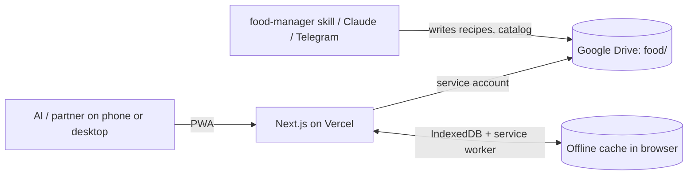

# High-Level Architecture: My Food Manager

> Project: `my-food-manager`
> Status: Approved (2026-10-28)
> Derived from: `product/product_vision.md` (approved 2026-10-28)

## 1. Architecture Drivers
- Data already lives in a Drive folder with a defined schema; Drive stays the source of truth (Vision §9).
- 2 users, 100+ recipes, daily use, tiny load (Vision §10): no scaling concerns.
- $0 budget, deploy on a free platform, built in "a few hours" (Vision §9).
- Offline is required, especially in the store (Vision §10, §5).
- No logins; a server-side Drive credential is acceptable (Vision §9).
- Writes must coexist with the food-manager skill editing the same folder (Vision §9, §11).
- Mobile-first visual experience: photos matter (Vision §8).

## 2. Architectural Style
One Next.js deployable on Vercel. Server route handlers are a thin gateway to Google Drive; the browser keeps an IndexedDB copy of the data and a service worker for offline. There is no database. The app reads a normalized snapshot, keeps working offline, and sends small intent operations back that the server applies to the latest Drive files. This is the simplest shape that gives offline use without a second data store.

## 3. System Context

## 4. Main Building Blocks
| Block | Responsibility |
|---|---|
| `lib/drive` | List and read the folder, write pantry/plan/reviews/curated with a modified-time check |
| `api/snapshot` | Build one normalized JSON of recipes, ingredients, pantry, reviews, vocabularies |
| `api/photo` | Proxy recipe photos from Drive with long cache headers |
| `api/ops` | Apply batches of intent operations (pantry, plan, reviews, curated), grouped per target file |
| `lib/domain` | Filters, search, "can cook now", shopping-list computation (pure, tested) |
| `lib/offline` | Snapshot cache, op outbox, replay on reconnect |
| UI (browse, detail, picks, list, pantry, reviews) | The MVP capabilities of Vision §5 |

## 5. Core Data Model (high level)
Mirrors the Drive schema: **Recipe** (ingredient lines → **Ingredient** catalog with family and staple flag), **Pantry** (`have`, `to_buy`), **Plan** (day → meals by slot → dishes with a recipe id, one shared household agenda), **Review** per user (favorites, ratings). Client-only state: current person, picked recipes ("my next cooks"), shopping-list tick state, and the outbox of pending operations. Picked recipes are local at first (shared across devices is a later decision, see §11).

## 6. Integrations
| Service | Used for | If unavailable |
|---|---|---|
| Google Drive API | Read and write the `food` folder | App serves the cached snapshot; writes queue in the outbox |

## 7. Deployment & Environments
Vercel Hobby, project root `apps/my-food-manager`, production on merge to `main`, free preview deployments per branch. Three environment variables hold the Drive credential, folder id and write key.

## 8. Cross-Cutting Concerns
- **Security:** no logins; Drive credential only on the server; writes gated by one shared key; service account limited to the one folder.
- **Conflicts:** operations are applied against the latest file with a modified-time check and one retry (ADR 001); last write wins per field for pantry/reviews; the plan merges per entry (adds append, removes of an absent entry are no-ops); multi-file batches are not atomic (ADR 003).
- **Observability:** Vercel function logs only.
- **Backups:** Drive file version history; the app never deletes files.

## 9. Deliberately Deferred
| Deferred | Why not now (driver) | Revisit when (concrete signal) |
|---|---|---|
| Database / index store (KV, Postgres) | Vision §10: 100s of files, 2 users; Drive is source of truth | Cold snapshot build > 5 s regularly, or Drive API quota errors |
| Precomputed `_index.json` written to Drive by food-manager | Adds coupling with the skill | Same signal as above |
| Real-time sync / websockets | Vision §10: not needed | Two people editing the same list simultaneously becomes a pain |
| CRDT / full offline merge | Per-field last-write-wins is enough for 2 users | Lost updates observed in practice |
| Auth / user accounts | Vision §9 | App becomes shared beyond the household or exposes sensitive data |
| CI pipeline, e2e tests | Vision §9 effort limits | Regressions reach production twice |
| Image processing pipeline | Photos are proxied as-is | Image payload makes list scrolling slow on mobile |

## 10. Key Decisions
| Decision | Chosen | ADR |
|---|---|---|
| Offline model and write conflicts | IndexedDB snapshot plus intent-operation outbox, server-side merge | [001](adr/001_offline-first-with-operation-outbox.md) |
| How the server reaches Drive | Service account with the folder shared to it, in env vars | [002](adr/002_drive-access-via-service-account.md) |
| Meal plan storage and writes | Shared `plan/plan.yaml` created by food-manager, per-entry intent operations | [003](adr/003_meal-plan-storage.md) |
| Framework | Next.js on Vercel | none (low reversal cost) |

## 11. Risks & Open Questions
- Cold-start snapshot build with 100+ file reads may be slow; mitigate with `modifiedTime` skipping and in-memory cache, measure before adding anything. Resolve during the first feature.
- Whether "my next cooks" (picks) should sync between the two phones or stay per device. Resolve at that feature's definition; the default is local only.
- Recipe photos do not exist yet (`_attachments` empty); the UI needs good placeholders until they do.
- Drive's modified-time check is not a true atomic compare-and-swap; accepted for 2 users.
